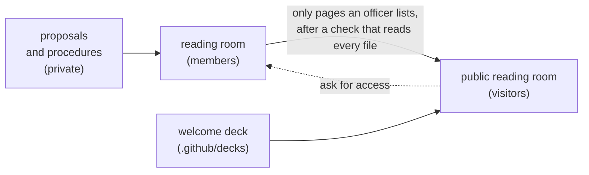

<!-- AUTO-GENERATED MIRROR — do not edit this file directly.
     Source of truth: https://github.com/psanctuary/.github/blob/main/profile/README.md
     This copy refreshes hourly via .github/workflows/mirror-profile-readme.yml -->

  <picture>
    <source media="(prefers-color-scheme: dark)" srcset="https://raw.githubusercontent.com/psanctuary/.github/main/profile/assets/banner-spore.svg">
    
  </picture>

  
  
  
  
  
  
  
  

In the church's own words:

> We are a non-profit mushroom church and psilocybin is our sacrament. Unlike anything else in the
> psychedelic ecosystem, Psanctuary offers a model centered on spiritual autonomy, peer support, and
> communal care. No gurus or celebrity shamans here. Just a sincere community, sharing wisdom.
>
> From [psanctuary.org](https://www.psanctuary.org)

##  Two organizations, one church

Psanctuary's real home is [psanctuary.org](https://www.psanctuary.org): Sunday service, membership,
courses, ceremonies and events all live there. On GitHub, the church holds two organizations, and
each has its own job:

| | |
| --- | --- |
|  **[psanctuarychurch](https://github.com/psanctuarychurch)** | The church's **professional face** on GitHub: its official home here, kept in order and out in the open. |
|  **psanctuary** (you're here) | The **decentralized, playful dimension**: experiments in tools the community can own, a little more color, and an open record of how it's all built. |

##  How a decentralized church can work

A mushroom has no headquarters. Underground, its mycelium links roots across a whole forest and
moves what's needed to wherever it's needed. This side of Psanctuary asks what a church could look
like if it grew the same way: many hands and no single center, members deciding together, and
thanks that can't be bought or sold. Some of that is a sneak peek, not a promise:

-  **A network of our own**: profiles and posts on open protocols like Lens and Farcaster, so what
  members share stays theirs, paired with **a Psanctuary DAO** where members propose ideas and decide
  together. Privacy first. ([The community window](https://psanctuary.github.io/#community) has the sneak peek.)
-  **Tokens of gratitude**: soulbound, non-transferable thank-yous from Christopher W's
  gratitude-token project. One stays in the wallet it's given to; it can't be sold, sent on or traded,
  and it isn't money. Still being tested; no dates.
-  **A pledge of support**, already here: sign a short pledge with a wallet. It's free, it sends
  nothing, nothing is recorded, and there are no counts. [Sign it](https://psanctuary.github.io/pledge/).

The [portal](https://psanctuary.github.io/#decentralized) has the longer version, with a mycelium you can
wake with your pointer.

##  Explore

| Where | What you'll find |
| --- | --- |
|  [Entry portal](https://psanctuary.github.io/) | Psanctuary's playful front door on GitHub: the latest changes, who made them, and the way into everything below. |
|  [AstroLog](https://psanctuary.github.io/changelog-astro-public/) | The front porch of Psanctuary's record: what changed, how it works, and who did the work. |
|  [Changelog](https://psanctuary.github.io/changelog-astro-public/changelog) | Dated, plain-language entries, newest first, each with the full story folded underneath. |
|  [Library](https://psanctuary.github.io/changelog-astro-public/library) | Longer write-ups on how these pages are built, and why. |
|  [Map](https://psanctuary.github.io/map/) | Every place these pages lead, each with a picture of where it goes. |
|  [Ledger](https://psanctuary.github.io/changelog-astro-public/ledger) | Every public change to the code, in plain words, grouped by day and by kind. Refreshed daily. |
|  [Donate](https://psanctuary.github.io/donate/) | Giving through psanctuary.org, receipts and taxes in the church's own words, a thank-you list, and a wallet preview. |
|  [Pledge](https://psanctuary.github.io/pledge/) | A pledge of support, signed with a wallet: free, nothing sent, nothing recorded, no counts. |
|  [Roadmap](https://psanctuary.github.io/changelog-astro-public/roadmap) | Where these pages are headed, without dates. |
|  [Sustainability](https://psanctuary.github.io/changelog-astro-public/sustainability) | What keeps them running, and the plan for them to outlive any one person. |
|  [Contacts](https://github.com/psanctuary/.github/blob/main/CONTACTS.md) | Every way to reach the church: info@psanctuary.org, the contact form, and its channels. |
|  [Community](https://psanctuary-member-community.mn.co/) | The church's member network on Mighty Networks: one link to join or sign in. |
|  [Social previews](https://github.com/psanctuary/.github/blob/main/SOCIAL-PREVIEWS.md) | How to refresh link previews in Telegram, LinkedIn, Facebook and more, and which pages have their own share image. |

Every page here shares one arrival kit: choose a light (Blacklight is this side's own), a pace and a
contrast when you arrive, press <kbd>/</kbd> to search, tap the book for reading mode, and see what's
new since your last visit. Move your pointer, and mycelium threads reach for the spores nearby.

##  Start here: the welcome deck, the rooms, the procedures

How Psanctuary decides, how it does things once decided, and slides that walk a newcomer through both.
Drafts are read first by the people who tend this space; a page reaches visitors only when someone marks
it public.

  
  
  

| | Where | What you'll find |
| --- | --- | --- |
|  | [**Welcome deck**](https://github.com/psanctuary/.github/blob/main/decks/welcome.marp.pdf) ([markdown](https://github.com/psanctuary/.github/blob/main/decks/welcome.marp.md)) | Seven stops, from "I have no GitHub account" to "I read, I answer, and my helper reads with me". All [decks](https://github.com/psanctuary/.github/tree/main/decks) live here. |
|  | [**SOP-COM-001**, New to GitHub: your first hour](https://github.com/psanctuary/ops-standard-operating-procedures/blob/main/COM/SOP-COM-001-new-to-github-your-first-hour.md) (members) | Your own account and password, two-factor, the invitation, five words, the reading room, a helper. |
|  | [**Reading room**](https://github.com/psanctuary/reading-room) (members) | Proposals, procedures and decks, each a page and a PDF, read in your browser. A 404 means "not in the readers team yet": ask below. |
|  | [**Public reading room**](https://psanctuary.github.io/reading-room-public/) | What's been marked for visitors, with the way into the members' room. |
|  | [**Procedures**](https://github.com/psanctuary/ops-standard-operating-procedures-public) (public copy) | The procedures (SOPs) marked public: *this is how we do it now*, each with a PDF. |
|  | [**Gitmoji**](https://github.com/drasticstatic/my-template/blob/main/GITMOJI.md) | How commits here are titled: one gitmoji and a type, `:memo: docs(room): …`. |

Want to read the drafts too? Write to info@psanctuary.org or use [the contact form](https://www.psanctuary.org/contact)
with your GitHub username. [ONBOARDING.md](https://github.com/psanctuary/.github/blob/main/ONBOARDING.md) says the rest.

##  People

| | |
| --- | --- |
| **Eric O** | Co-founded Psanctuary with **Courtney M** and **Athena**. |
| **Alana** | A minister leading the **Maine** frontier, and part of the web-dev team. |
| **Christopher W** ([@drasticstatic](https://github.com/drasticstatic)) | Leads the **Pennsylvania** frontier, and looks after Psanctuary's GitHub home with [Alfred](https://github.com/drasticstatic/anthropas-argus-alfred-public-preview). |

**Why there's no Discord:** Psanctuary once had one, and Eric O closed it on purpose, so the
community gathers in one place, on [Mighty Networks](https://psanctuary-member-community.mn.co/). A
Discord may only ever return as a help-desk back end most people would never see, unless a DAO or
something new grows here. Time will tell.

##  Repositories

| Repository | What it holds |
| --- | --- |
| [psanctuary.github.io](https://github.com/psanctuary/psanctuary.github.io) | The entry portal (`/`, `/donate/`, `/pledge/`, `/map/`), which also serves the arrival kit every Psanctuary page shares. |
| [changelog-astro-public](https://github.com/psanctuary/changelog-astro-public) | The AstroLog's published pages (written in a private source repository). |
| [reading-room-public](https://github.com/psanctuary/reading-room-public) | The public reading room's pages, served at [psanctuary.github.io/reading-room-public](https://psanctuary.github.io/reading-room-public/); copied from the members' room, never edited by hand. |
| [ops-standard-operating-procedures-public](https://github.com/psanctuary/ops-standard-operating-procedures-public) | The procedures marked public, each with a PDF; copied from the private procedures, never edited by hand. |
| [.github](https://github.com/psanctuary/.github) | This profile, the defaults every repository here shares, and the [decks](https://github.com/psanctuary/.github/tree/main/decks). |

##  Community health

- [`CONTACTS.md`](https://github.com/psanctuary/.github/blob/main/CONTACTS.md): every way to reach the church
- [`ONBOARDING.md`](https://github.com/psanctuary/.github/blob/main/ONBOARDING.md): **joined the organization? start here**: two-factor login, connecting your AI helper, and how we work
- [`CONTRIBUTING.md`](https://github.com/psanctuary/.github/blob/main/CONTRIBUTING.md): how to help, gently
- [`SECURITY.md`](https://github.com/psanctuary/.github/blob/main/SECURITY.md): reporting a security problem
- [`SOCIAL-PREVIEWS.md`](https://github.com/psanctuary/.github/blob/main/SOCIAL-PREVIEWS.md): how to refresh link previews, and which pages have their own share image

##  License

-  **Code:** MIT, see [`LICENSE`](https://github.com/psanctuary/.github/blob/main/LICENSE)
-  **Written content** (docs, changelog and library prose, READMEs): CC BY-SA 4.0, see [`LICENSE-CONTENT`](https://github.com/psanctuary/.github/blob/main/LICENSE-CONTENT)
-  **The Psanctuary name, logos and marks:** not covered by either license, see [`TRADEMARKS.md`](https://github.com/psanctuary/.github/blob/main/TRADEMARKS.md)

---

Icons: <a href="https://lucide.dev">Lucide</a> (ISC), toned teal. Everything here was gathered from psanctuary.org's own words, so it's sure to have gaps. The
people who tend this community know it far better than any page can, and this space is theirs to grow.

